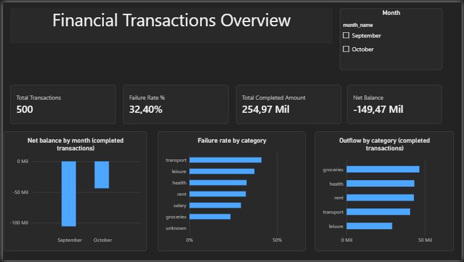
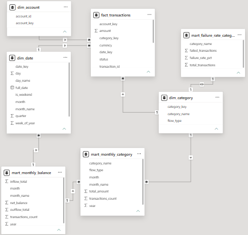

# Power BI dashboard

A Power BI report built on the gold layer of this project (star schema in Import mode).

## Files

- `dashboard_overview.png`: screenshot of the report page.
- `model_view.png`: screenshot of the data model.

The `.pbix` file is not included in this repository. To rebuild the report, connect Power BI Desktop to a Databricks SQL warehouse (Databricks connector, Import mode), load the seven gold tables (`fact_transactions`, the three dimensions and the three marts), create the relationships described below and add the measures defined in this document.

## Data model

Fact and dimensions from `workspace.gold`, related by key (many-to-one, single direction):

- `fact_transactions` -> `dim_date` (`date_key`)
- `fact_transactions` -> `dim_category` (`category_key`)
- `fact_transactions` -> `dim_account` (`account_key`)

The three marts (`mart_monthly_category`, `mart_monthly_balance`, `mart_failure_rate_category`) are also loaded and used as a reference to reconcile the measures.

## Measures (DAX)

| Measure | Business rule | Definition |
|---|---|---|
| Total Transactions | | `COUNTROWS(fact_transactions)` |
| Failed Transactions | | `CALCULATE(COUNTROWS(fact_transactions), fact_transactions[status] = "failed") + 0` |
| Failure Rate % | BR-03 | `DIVIDE([Failed Transactions], [Total Transactions])` |
| Total Completed Amount | BR-01 | `CALCULATE(SUM(fact_transactions[amount]), fact_transactions[status] = "completed")` |
| Inflow Amount | | `CALCULATE([Total Completed Amount], dim_category[flow_type] = "inflow")` |
| Outflow Amount | | `CALCULATE([Total Completed Amount], dim_category[flow_type] = "outflow")` |
| Net Balance | BR-02 | `[Inflow Amount] - [Outflow Amount]` |

The `+ 0` in Failed Transactions returns 0 instead of blank, so categories without failures (such as `unknown`) stay visible.

## Reconciliation with the gold layer

The measures match the marts built in Databricks:

- 500 transactions, 162 failed, failure rate 32.40%
- Total completed amount: 254,973.75
- Net balance: September -105,686.72, October -43,779.01, total -149,465.73

## Notes

- October covers only 2026-10-01 to 2026-10-11 (partial month), so it should not be compared directly with September.
- Small groups can mislead: `unknown` has only 2 transactions, so its 0% failure rate is not meaningful.
- Power BI Desktop runs only on Windows.
